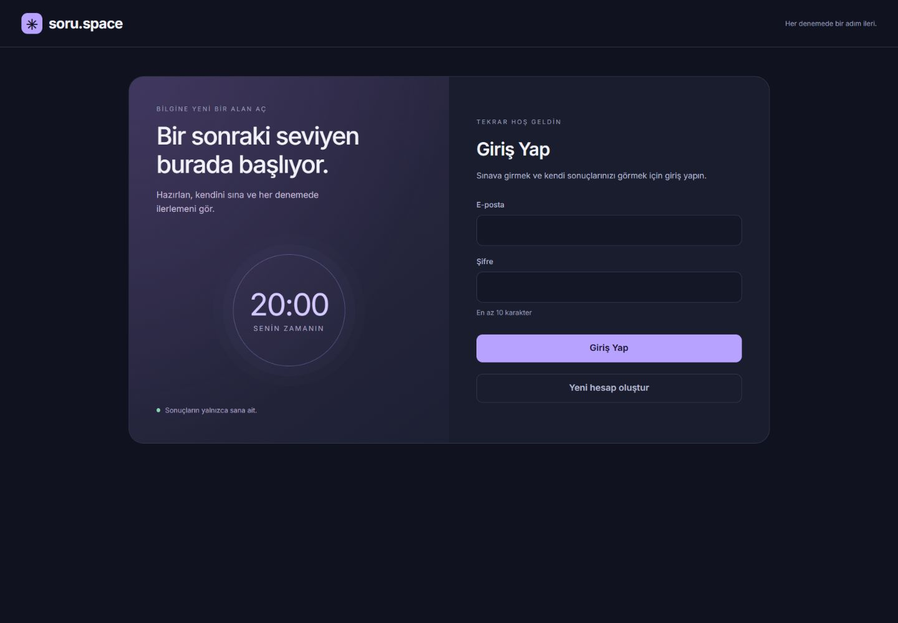
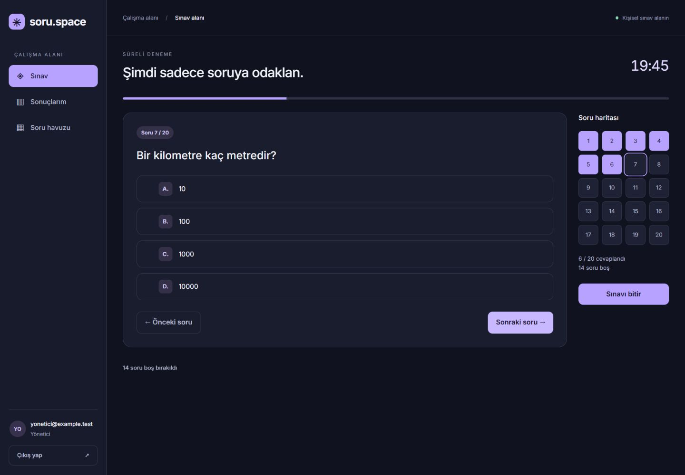
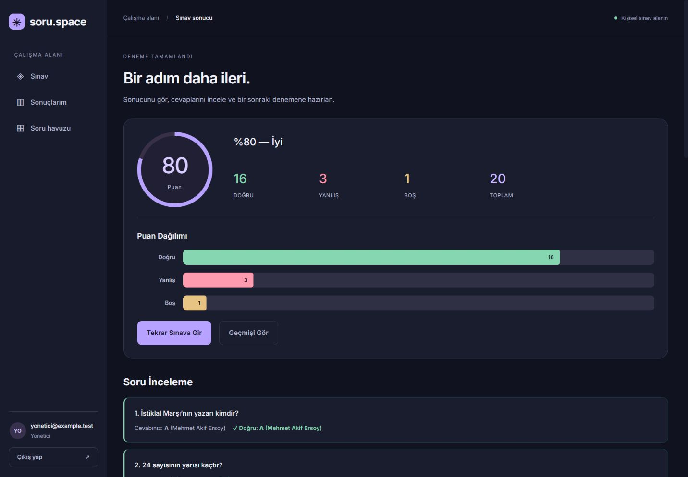
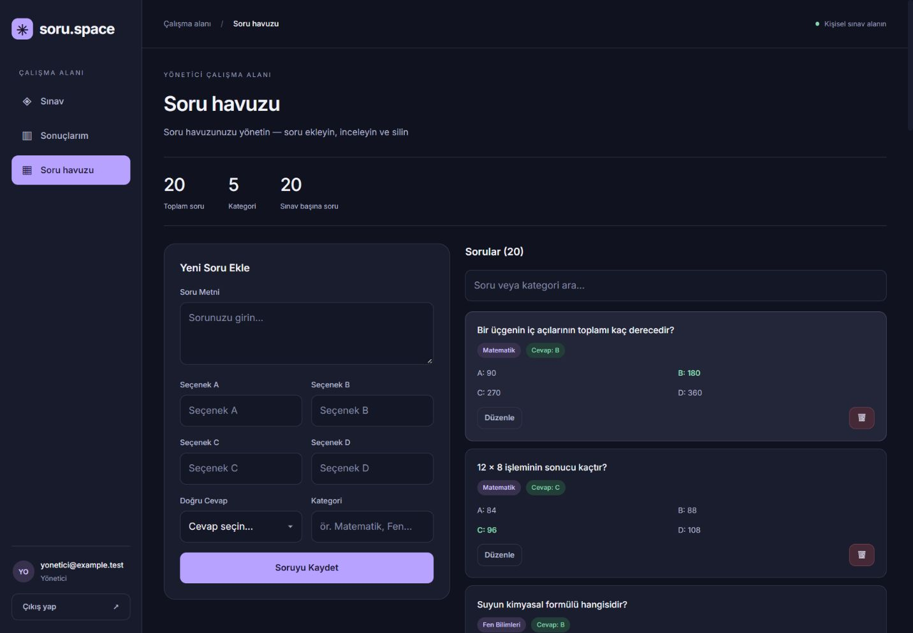
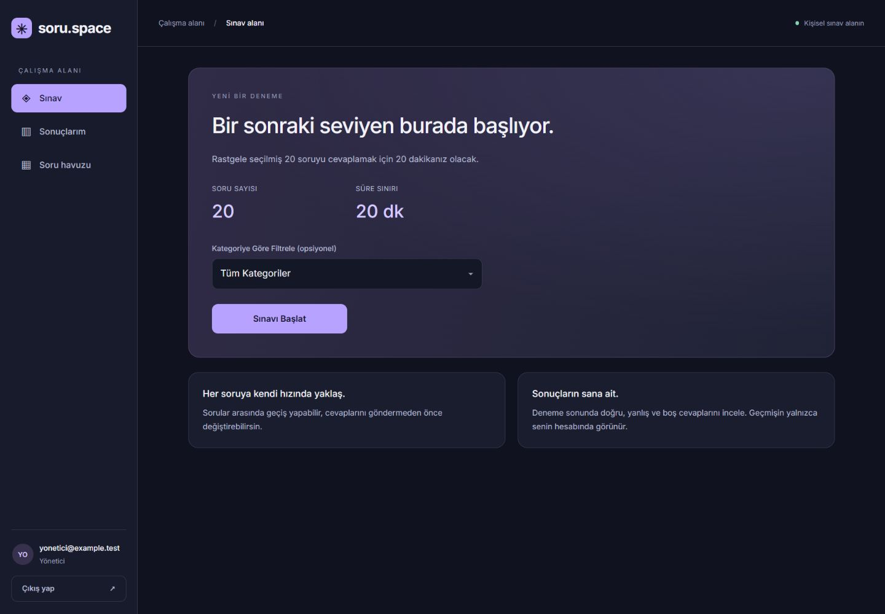
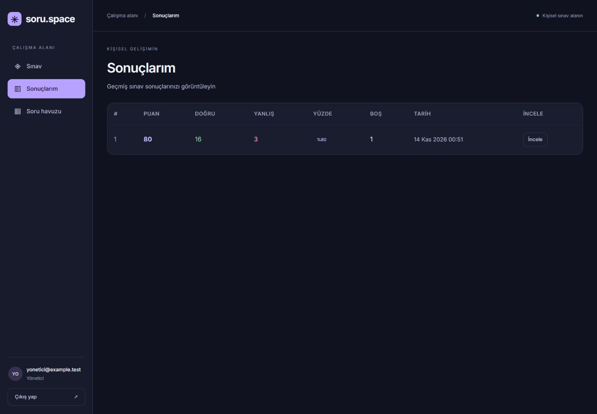
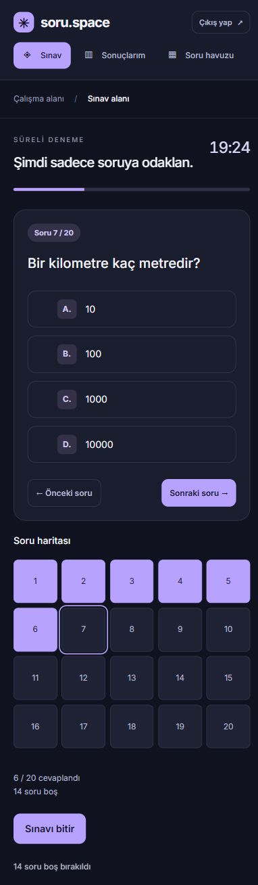

# Soru Havuzu

[](https://github.com/ademkrks/Soru-havuzu/actions/workflows/check.yml)

Kullanıcı girişi, yönetici yetkilendirmesi ve kişisel sonuç takibi sunan soru havuzu tabanlı online sınav uygulaması. React arayüzü ve Node.js sunucusu birlikte çalışır. **Gece** tasarımı, masaüstünde sol menüye ve mobilde üst gezinmeye uyum sağlar.

## Özellikler

- E-posta ve şifreyle kayıt, giriş ve çıkış
- Yalnız yöneticiye açık soru havuzu; soru ekleme, düzenleme, silme ve arama
- Her kullanıcıya yalnız kendi sınavları, sonuç geçmişi ve cevap detayları
- İsteğe bağlı kategori seçimiyle rastgele, tekrarsız **20 soru / 20 dakika**
- Tek soru görünümü, önceki/sonraki geçiş ve cevap durumunu gösteren soru haritası
- Seçim sırasında sunucuya cevap kaydı; aynı sekmede yenileme sonrası devam
- Süre sonunda otomatik gönderim ve bağlantı kesintisinde yeniden gönderim
- Tekrarlanan gönderimde tek sonuç; 100 üzerinden puan ve cevap inceleme
- Sorular değişse veya silinse bile önceki sınav içeriğinin korunması
- Koyu Gece teması, klavye odağı ve azaltılmış hareket desteği

## Ekran görüntüleri

Gece tasarımının gerçek uygulama ekranları. Görüntüler örnek hesap ve sorularla alınmıştır; gerçek kullanıcı verisi içermez.

### Giriş



### Sınav



### Sonuç



### Yönetim



<details>
<summary>Sınava hazırlık, sonuç geçmişi ve mobil görünüm</summary>

### Sınava hazırlık



### Sonuç geçmişi



### Mobil sınav



</details>

## Teknolojiler

React 18 · React Router 7 · Vite 8 · Node.js 22.12+ · Node.js test runner

Veriler JSON dosyasında saklanır. Ek bir veritabanı veya ayrı backend deposu gerekmez.

## İlk kurulum

### 1. Depoyu indirin ve bağımlılıkları kurun

```sh
git clone https://github.com/ademkrks/Soru-havuzu.git
cd Soru-havuzu
npm ci
```

Node.js **22.12 veya üzeri** ve npm gerekir. Komutları depo kökünde çalıştırın.

### 2. Yönetici hesabını oluşturun

Sunucu kapalıyken PowerShell'de çalıştırın. Şifre ekranda gösterilmez ve kaynak koduna yazılmaz.

```powershell
$env:ADMIN_EMAIL = Read-Host 'Yönetici e-postası'
$adminSecret = Read-Host 'Yönetici şifresi (10–128 karakter)' -AsSecureString
$env:ADMIN_PASSWORD = [System.Net.NetworkCredential]::new('', $adminSecret).Password
try {
    npm run admin
    if ($LASTEXITCODE -ne 0) { throw 'Yönetici hesabı oluşturulamadı.' }
} finally {
    Remove-Item Env:ADMIN_PASSWORD -ErrorAction SilentlyContinue
    Remove-Item Env:ADMIN_EMAIL -ErrorAction SilentlyContinue
    Remove-Variable adminSecret -ErrorAction SilentlyContinue
}
```

`npm run admin`, `ADMIN_EMAIL` ve `ADMIN_PASSWORD` ortam değişkenlerini okur. Başka kabuklarda da bu iki değişkeni belirleyip aynı komutu çalıştırabilirsiniz. `.env` dosyaları kendiliğinden yüklenmez.

E-posta kayıtlıysa komut hesabı yöneticiye yükseltir, şifresini yeniler ve açık oturumlarını kapatır. Yeni e-postada yönetici oluşturur. Varsayılan hesap veya sabit şifre yoktur. `DATA_FILE` kullanıyorsanız kurulumda ve sunucuda aynı dosyayı seçin.

### 3. Uygulamayı başlatın

```sh
npm run dev
```

- Arayüz: <http://localhost:3000>
- Sunucu: <http://localhost:5000>

Tek komut ikisini birlikte başlatır; Ctrl+C ile durdurulur. Yalnız sunucuyu geliştirme modunda açmak için `npm run server` kullanın.

### 4. Soru havuzunu hazırlayın

Yönetici hesabıyla giriş yapıp **Soru havuzu** bölümünden en az 20 soru ekleyin. Kategoriye özel sınav için o kategoride en az 20 soru bulunmalı. Normal kullanıcılar **Yeni hesap oluştur** düğmesiyle kayıt olur.

Her doğru cevap 5 puandır. Yanlış cevap doğruları götürmez; boş cevap puan kazandırmaz.

## Sayfalar ve yetkiler

| Sayfa | Adres | Erişim |
| --- | --- | --- |
| Giriş / kayıt | `/giris` | Herkes |
| Soru havuzu | `/` | Yönetici; normal kullanıcı sınava yönlendirilir |
| Sınav hazırlığı / sınav | `/sinav` | Giriş yapan kullanıcı |
| Sonuç detayı | `/sonuc` | Yalnız sonucun sahibi |
| Sonuç geçmişi | `/sonuclar` | Yalnız kullanıcının kendi sonuçları |

Yönetici de sadece kendi sonuçlarını görür. Yetkiler sunucuda denetlenir.

## Derleme ve çalıştırma

```sh
npm run build
npm start
```

<http://localhost:5000> hem arayüzü hem API'yi sunar. Sayfalara doğrudan erişim desteklenir. `npm run preview` yalnızca arayüzü önizler; tam uygulama için `npm start` kullanın.

HTTPS üzerinden yayınlarken `NODE_ENV=production` ayarlayın; oturum çerezi `Secure` olur. Düz HTTP ile yerel denemede bu ayarı kullanmayın. HTTPS ters vekili dışarıdaki adresle tutarlı `Host` bilgisi iletmelidir.

## Ayarlar

| Değişken | Varsayılan | Açıklama |
| --- | --- | --- |
| `PORT` | `5000` | Sunucu portu |
| `HOST` | `127.0.0.1` | Dinlenecek adres |
| `DATA_FILE` | `data/database.json` | Göreli yollar çalışma dizinine göre çözülür |
| `NODE_ENV` | Ayarlanmamış | `production` olduğunda oturum çerezi yalnız HTTPS ile gönderilir |
| `ADMIN_EMAIL` | Yok | Yalnız yönetici kurulum komutunun kullandığı e-posta |
| `ADMIN_PASSWORD` | Yok | Yalnız yönetici kurulum komutunun kullandığı şifre |

Vite API isteklerini 5000 portuna yönlendirir. Portu değiştirirseniz `vite.config.js` içindeki yönlendirmeyi de güncelleyin. Ortam değişkenlerini uygulamayı başlatmadan önce kabuğunuzda belirleyin.

## Veri ve oturumlar

- Hesap, oturum, soru ve sonuçlar `data/database.json` dosyasında tutulur; dosya Git'e alınmaz.
- Yedek almak veya `npm run admin` çalıştırmak için sunucuyu durdurun. Aynı veri dosyasına yalnız bir süreç yazmalıdır.
- Bozuk veri dosyası sessizce sıfırlanmaz; sunucu hata vererek durur.
- Şifreler rastgele tuzla scrypt kullanılarak özetlenir. Çerezler `HttpOnly` ve `SameSite=Strict` kullanır; oturum süresi 24 saattir.
- Çıkış oturumu iptal eder. Giriş/kayıt IP başına 15 dakikada 30 denemeyle sınırlıdır.
- Süre sunucuda tutulur; yenilemeyle sıfırlanmaz. Süre sonrasında son kaydedilmiş cevaplar değerlendirilir.
- Bir günden fazla süredir bitmiş sınav oturumları yeni sınav açılırken temizlenir; sonuçlar kalır.
- Önceki sürümlerin sahibi bilinmeyen sonuçları silinmez veya yeni hesaplara atanmaz; kişisel sonuç API'sinde görünmez.

Dosya tabanlı sürüm yüksek eşzamanlı yük veya birden fazla sunucu süreci için tasarlanmamıştır. E-posta doğrulaması, şifremi unuttum akışı ve kullanıcı yönetimi ekranı henüz bulunmaz.

## API

Yazma istekleri `Content-Type: application/json` kullanır; varsa `Origin` denetlenir. Kimlik oturum çerezinden belirlenir.

| Yöntem | Adres | İşlev / erişim |
| --- | --- | --- |
| POST | `/api/auth/kayit` | Normal kullanıcı oluşturur: `email`, `password` |
| POST | `/api/auth/giris` | Oturum açar: `email`, `password` |
| GET | `/api/auth/ben` | Giriş yapan hesap |
| POST | `/api/auth/cikis` | Oturumu kapatır; JSON gövde `{}` |
| GET / POST | `/api/sorular` | Listele / ekle; yönetici |
| PUT / DELETE | `/api/sorular/:id` | Düzenle / sil; yönetici |
| GET | `/api/sorular/kategoriler` | Kategoriler; giriş gerekli |
| POST | `/api/sinav/baslat` | `{ "kategori": "Matematik" }` veya `{}`; giriş gerekli |
| PUT | `/api/sinav/cevaplar` | `sinav_id` ve soru kimliği → şık eşlemesi olan `cevaplar`; sınav sahibi |
| POST | `/api/sinav/gonder` | `sinav_id` ve `soru_id` / `secilen_cevap` alanlarından oluşan `cevaplar` dizisi; sınav sahibi |
| GET | `/api/sonuclar` | Yalnız kullanıcının sonuçları |
| GET | `/api/sonuclar/:id` | Yalnız sahibine açılan sonuç detayı |

## Kontrol ve belgeler

```sh
npm test
npm run build
npm audit
```

GitHub Actions her push ve pull request için test ve derleme yapar. Testler geçici dosyalar ve gerçek HTTP istekleriyle soru yönetimini, sınavı, puanlamayı, süreyi, oturumları ve kullanıcılar arası erişim engellerini kontrol eder.

- [Gece tasarımı ve ekran kontrolleri](docs/gece-tasarimi.md)
- [Kullanıcı ve yetki testleri](docs/yetki-testleri.md)
- [İlk tarayıcı testleri](docs/tarayici-testleri.md) — önceki sürüme ait tarihli kayıt
- [Katkı rehberi](CONTRIBUTING.md)
- [Güvenlik bildirimi](SECURITY.md)

## Proje yapısı

```text
src/
  App.jsx        # Gezinme ve korumalı sayfalar
  auth.jsx       # Oturum durumu ve API istekleri
  gece.css       # Gece tasarımı
  pages/         # Giriş, yönetim, sınav ve sonuçlar
server/
  app.js         # API ve üretim dosyalarının sunulması
  auth.js        # Şifre ve oturum yardımcıları
  store.js       # Kalıcı kayıt ve eski veri uyumluluğu
scripts/
  admin.js       # Yönetici kurulumu
  dev.js         # Arayüz ve sunucunun başlatılması
test/            # Sınav ve yetki testleri
docs/            # Tasarım ve tarayıcı kontrol notları
```

## Lisans

Bu depo için henüz bir lisans seçilmemiştir.
